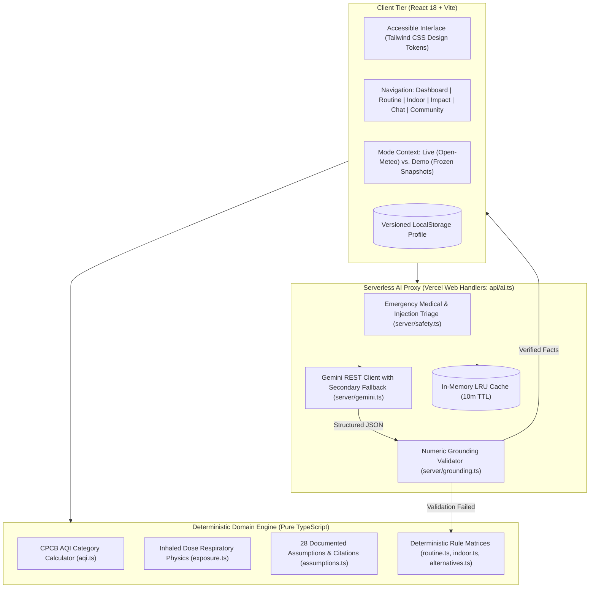

# Saans (सांस) — Urban Air Quality Assistant

> **A GenAI-powered, mathematically grounded assistant helping families and communities navigate severe winter smog with low-emission routines, indoor air quality hacks, and sustainable lifestyle alternatives.**  
> Built from scratch for **Google PromptWars Virtual, Challenge 6: "Urban Air Quality Assistant"** (India-Only Program, November 2026).

---

## 1. Challenge Mapping

This table explicitly links every core phrase of the Google PromptWars Challenge 6 Problem Statement to its corresponding software implementation, source file, and where to inspect it in the live application:

| Problem Statement Phrase | Implementation Feature | Source Code Location | Where to Inspect in App |
| :--- | :--- | :--- | :--- |
| **"GenAI-powered assistant"** | Purpose-limited Gemini proxy (`api/ai.ts`), server-held system prompts, and interactive conversational interface with provenance tracking. | `api/ai.ts`<br>`server/gemini.ts`<br>`src/features/assistant/` | **"Assistant" tab** in main navigation; chat UI with quick chips & provenance badges. |
| **"helps families and communities"** | Household vulnerability profiles (infants, elderly, asthma/COPD, pregnancy) & RWA / school community kits. | `src/features/onboarding/`<br>`src/features/community/` | **"Profile Wizard"** modal & **"Community Kit" tab** (circulars & copyable WhatsApp notices). |
| **"navigate severe winter smog"** | Real-time CPCB AQI estimation, pollutant breakdown, WHO 2021 & NAAQS gauges, and weather inversion analysis. | `src/domain/aqi.ts`<br>`src/features/dashboard/`<br>`src/features/outlook/` | **"Today Dashboard"** & **"24–48h Outlook"** (custom SVG chart with safe activity windows). |
| **"low-emission daily routines"** | Deterministic 8-period daily action schedule tailored to CPCB AQI tier and household commute types. | `src/domain/routine.ts`<br>`src/features/routine/` | **"Daily Routine" tab**; time-blocked cards with action, data why, effort, and cost band. |
| **"indoor air quality hacks"** | Room-specific advice, CADR room sizing calculator, ventilation countdown timer, gap sealing, and Corsi-Rosenthal DIY box instructions. | `src/domain/indoor.ts`<br>`src/features/indoor/` | **"Indoor Air Hacks" tab**; room selector, purifier CADR calculator, and myth-busting accordion. |
| **"sustainable alternatives"** | Transport and routine modal comparisons showing travel $\text{CO}_2\text{e}$ emissions savings per trip. | `src/domain/alternatives.ts`<br>`src/features/impact/` | **"Impact Explainer" tab**; vehicle comparisons with quantified $\text{g CO}_2\text{e}$ bars. |
| **"tailored to location and lifestyle"** | 2-decimal rounded geolocation, Open-Meteo live API integration, and versioned multi-factor profile storage. | `src/services/airQuality.ts`<br>`src/services/profile.ts` | **Top Location Bar** (City search & "Use My Location") & **Profile Wizard**. |
| **"clearly explaining direct impact"** | Quantified relative inhaled dose exposure reductions (%) with uncertainty bounds and plain-language assumptions. | `src/domain/exposure.ts`<br>`src/features/impact/` | **"Impact Explainer" tab**; side-by-side relative dose differential card. |

---

## 2. Chosen Vertical and Target Persona

- **Geographic Vertical**: Urban households in North India during the severe winter smog window (November–February), with focus on the Indo-Gangetic Plain (Delhi-NCR, Lucknow, Kanpur, Patna, Agra, Varanasi).
- **Core Household Persona**: Multi-generational middle-class urban families living in naturally ventilated brick/concrete apartments or independent floors, with mixed transportation and varied physiological vulnerability.
- **Household Sub-Personas**:
  1. *Vulnerable Family*: Toddler (0–3) + asthmatic senior citizen (65+). High sensitivity to peak morning thermal inversion (6:00 AM – 10:00 AM).
  2. *Two-Wheeler Commuting Couple*: Daily 15 km road commute on petrol 2-wheeler across high-traffic corridors with open-air particulate exposure.
  3. *Community & RWA Administrator*: Managing residential welfare associations or schools requiring objective AQI-based outdoor activity cancellation and anti-open-burning circulars.

---

## 3. Approach and Architectural Logic



### Core Logic Principles
1. **Separation of Math and Narration**: Every number shown in the application (AQI, pollutant concentration, exposure reduction %, purifier CADR sizing, $\text{CO}_2\text{e}$ emissions) is calculated deterministically by the pure TypeScript domain engine (`src/domain/`). The LLM is never allowed to generate, guess, or extrapolate mathematical values.
2. **Transparent Provenance Tracking**: Every AI-capable component carries a visible badge indicating `source: 'gemini'` (with model name and latency) or `source: 'rules'` (with a 1-click Retry button).
3. **Strict Grounding Enforcement**: A server-side regex validator checks that every numeral in the model's text matches context facts supplied by the engine. If ungrounded numbers appear, it retries once with an explicit prompt injunction before transparently falling back to deterministic rules.
4. **Emergency Safety Triage**: Red-flag medical symptoms (chest pain, severe breathlessness, fainting, blue lips, infant distress) in English, Hindi, or Hinglish bypass the LLM completely to provide fixed emergency guidance directing the user to dial 112 or visit a hospital.

---

## 4. Operating Modes: Demo Mode vs. Live Mode

| Dimension | Demo Mode (Default 1-Click) | Live Mode (Real-World) |
| :--- | :--- | :--- |
| **First-Load Experience** | Default first paint (instant, zero network or key required). | Activated via City Search or *"Use My Location"*. |
| **Data Source** | Curated, frozen historical snapshots: Delhi (Severe), Lucknow (Poor), Mumbai (Moderate), Bengaluru (Satisfactory). | Live Open-Meteo Air Quality, Forecast, and Geocoding APIs. |
| **Location Privacy** | None required; uses frozen city coordinates. | Browser geolocation rounded to 2 decimal places ($\approx 1.1\text{ km}$ precision); names/exact coordinates never sent over network. |
| **Network Failure Handling** | Completely offline-resilient; zero network dependency. | Gracefully offers manual entry (*"Enter your purifier or app reading"*), clearly labeled `user-entered reading`. |
| **Banner Notice** | Persistent banner: *"Demo mode: sample air-quality data. AI answers are live."* | Mode switch indicator with instant toggle back to Demo. |

---

## 5. How Gemini is Used vs. Where Rules are Used

To prevent hallucinations and guarantee safety, AI is strictly purpose-limited:

- **What Uses Gemini (`api/ai.ts`)**:
  - `narrate-plan`: Synthesizing rule-generated schedules into personal household plans.
  - `explain-impact`: Translating mathematical dose deltas into plain-language actionable advice.
  - `chat`: Context-grounded Q&A answering queries using exclusively active weather facts and profile categories.
  - `indoor-tips`: Tailored room-by-room air quality recommendations.
  - `community-message`: Generating RWA and school WhatsApp broadcast notices.
- **What Uses Deterministic Rules (`src/domain/`)**:
  - All CPCB sub-index calculations and piecewise interpolation formulas.
  - All respiratory inhaled dose calculations ($\text{Dose} = \text{PM}_{2.5} \times V_E \times t \times f_{\text{env}} \times (1 - \eta) \times w_{\text{vuln}}$).
  - All travel emission calculations ($\text{g CO}_2\text{e/pkm}$).
  - All time-blocked routine items, reason codes, and effort/cost bands.
  - Medical triage symptom matching and emergency redirects.

---

## 6. Scientific Data Sources and Citations

All domain coefficients and physical standards are cited in [docs/DATA_AND_ASSUMPTIONS.md](file:///c:/promptwars/Urban%20Air%20Quality%20Assistant/docs/DATA_AND_ASSUMPTIONS.md):
- **Central Pollution Control Board (CPCB) India**: *National Air Quality Index (NAQI) Standards and Breakpoint Specifications (2014)*.
- **World Health Organization (WHO)**: *Global Air Quality Guidelines (2021) for PM2.5, PM10, and NO2*.
- **US EPA**: *Exposure Factors Handbook (2011 Edition, Chapter 6: Inhalation Rates)*.
- **Indian Transport & Microenvironment Studies**: *Goel & Kumar (2015), Atmospheric Environment*; *Apte et al. (2011)*; *TERI / DMRC Life-Cycle Carbon Emissions Study (2020)*.

---

## 7. Security, Privacy, and Accessibility

### Security
- **Server-Only API Key**: `GEMINI_API_KEY` is loaded only in serverless edge handlers. Client bundles are scanned with `check:no-client-secrets` to guarantee zero key leakage.
- **Strict Content Security Policy (CSP)**: No `unsafe-eval`, no inline scripts. Production headers include HSTS, nosniff, `X-Frame-Options: DENY`, and `Cache-Control: no-store` on `/api`.
- **Input Sanitization**: Length limits, zero-width space stripping, and Zod validation on every input vector.

### Privacy
- **Zero Tracking**: No user tracking, analytics scripts, or third-party tracking pixels.
- **Local Storage Isolation**: Profiles reside strictly in the user's browser `localStorage`, with schema versioning and an accessible *"Clear my data"* button.
- **Coordinate Truncation**: Geolocation coordinates are mathematically rounded to 2 decimal places before leaving the client.

### Accessibility (WCAG 2.2 AA)
- **High Contrast**: All text ($\ge 4.5:1$) and interactive boundaries ($\ge 3:1$) pass contrast tests in both Light and Dark themes.
- **Non-Color Conveyance**: AQI category is always communicated using color + text label + distinct icon.
- **Semantic HTML & Focus Management**: Semantic landmarks (`<header>`, `<main>`, `<footer>`), keyboard skip links, and focus-trapped dialogs (`useFocusTrap.ts`) supporting `Esc` dismissal.
- **Accessible Charting**: The 24–48h hourly outlook is rendered using pure inline SVG coordinate scaling (zero chart libraries) paired with a semantic HTML data table alternative.

---

## 8. Installation, Local Run, and Deployment

### Prerequisites
- Node.js $\ge 20.0.0$ (pinned in `.nvmrc` and `engines`)
- npm $\ge 10.0.0$

### Local Development Setup
```powershell
# 1. Clone repository
git clone https://github.com/Sitanshudevop/Air_Quality_Assistant.git
cd Air_Quality_Assistant

# 2. Install dependencies
npm ci

# 3. Configure local environment
Copy-Item .env.example .env
# Open .env and insert your GEMINI_API_KEY (optional for demo mode; required for live AI responses)

# 4. Start local development server (serves frontend + dev /api middleware)
npm run dev
# Open http://localhost:5173
```

### Running Tests & Quality Checks
```powershell
# Run full Vitest unit & accessibility tests
npm test

# Run tests with coverage reporting
npm run test:coverage

# Run TypeScript checks across client and serverless targets
npm run typecheck
npm run typecheck:api

# Run linter and code hygiene audits
npm run lint
npm run check:no-client-secrets
npm run knip
npm run jscpd
npm run madge
```

### Production Deployment (Vercel)
1. Import repository at [vercel.com/new](https://vercel.com/new).
2. Framework Preset: **Vite**; Root Directory: `./`.
3. Set Environment Variable: `GEMINI_API_KEY = <your-gemini-api-key>`.
4. Deploy! Run smoke test:
   ```powershell
   node scripts/smoke-deployed.mjs https://<your-app>.vercel.app --prompts
   ```

---

## 9. Known Limitations

In the interest of engineering honesty and scientific rigor:
1. **Model-Based Forecasts vs. Ground Stations**: Live outdoor data is retrieved from the Open-Meteo atmospheric dispersion model and satellite reanalysis. Local micro-hotspots (e.g., immediate proximity to open trash burning or brick kilns) may exceed regional model estimates.
2. **Serverless Edge Rate Limiting**: In-memory rate limiting and LRU caching are scoped per serverless instance (standard Vercel edge execution model).
3. **Not Medical Advice**: Inhaled dose calculations are relative comparative physical models, not clinical prognosticators.
