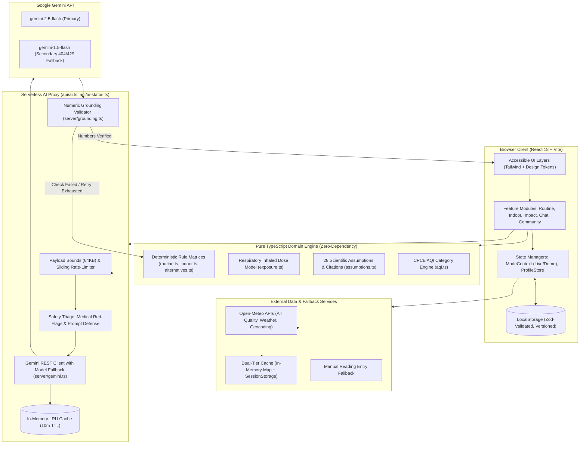

# Architecture & System Design — "Saans" (सांस)

"Saans" is a high-reliability, full-stack web application designed for North Indian urban families navigating severe winter smog. It marries deterministic mathematical modeling (CPCB breakpoints, respiratory dose intake physics) with context-grounded GenAI narration powered by Google Gemini.

---

## 1. High-Level System Architecture

---

## 2. Architectural Pillars

### A. Separation of Math and Narration
- **Zero AI Math Hallucination**: No numeric value presented to the user (AQI, pollutant concentration, exposure delta %, CADR sizing, or travel $\text{CO}_2\text{e}$) is generated by the LLM. All numbers originate exclusively from `src/domain/`.
- **Purpose-Limited AI Role**: Gemini is restricted to five discrete, allow-listed tasks:
  1. `narrate-plan`: Synthesizing the rule-generated daily routine into personal, empathetic household guidance.
  2. `explain-impact`: Translating relative dose differentials into actionable everyday decisions.
  3. `chat`: Grounded question-answering restricted strictly to user context and domain facts.
  4. `indoor-tips`: Room-specific air cleaning recommendations.
  5. `community-message`: Drafting formal RWA circulars and copyable WhatsApp broadcasts.

### B. Purpose-Limited Serverless Proxy Hardening
- **Web Handler Standard**: Handlers in `api/` export standard named functions (`GET`, `POST`) returning Web-standard `Response` objects.
- **Streaming Body & Payload Limits**: Rejects payloads exceeding 64 KB (`413 Payload Too Large`).
- **Secret Isolation**: `GEMINI_API_KEY` exists strictly on the server in `.env` and Vercel environment variables. The client never receives or stores any API key.
- **Sliding-Window Rate Limiting**: Per-instance in-memory rate limiter protects endpoints against volumetric abuse.
- **Sanitized Errors**: The proxy catches all errors and returns standardized JSON envelopes (`400`, `405`, `413`, `429`, `503`, `504`) with zero internal stack traces or prompt leakage.

### C. Numeric Fact Grounding (`server/grounding.ts`)
Before any AI response reaches the user, the server executes strict numeric grounding:
1. All numerals (including comma-grouped digits, decimals, negative percentages, Unicode minus signs `\u2212`, and Devanagari numerals `०`–`९`) are extracted from the candidate text.
2. Every extracted number must be a member of the allowed fact set passed from the domain engine (or standard linguistic counters such as 1–3).
3. If an ungrounded number is detected, the server automatically retries once with an explicit prompt injunction. If it fails a second time, the server transparently falls back to the deterministic domain rule text with `source: 'rules'`.

### D. Medical Safety & Prompt Injection Defense (`server/safety.ts`)
- **Medical Refusal**: The assistant explicitly states it is an air-quality decision support tool, not a medical clinician.
- **Emergency Triage**: Multi-lingual scanner (English, Hindi, and Hinglish) actively checks for red-flag symptoms:
  - Chest pain / छाती में दर्द / seene mein dard
  - Severe breathlessness / सांस लेने में तकलीफ / saans lene mein dikkat
  - Blue lips / fainting / चक्कर खाकर गिरना
  - Infant respiratory distress
  *When detected, the LLM is bypassed immediately, returning fixed life-safety guidance directing the user to dial 112 or seek immediate medical care.*
- **Injection Defense**: Untrusted user text is isolated inside `<untrusted_user_text>` enclosures with strict system instructions prohibiting roleplay overrides or instructions to reveal system prompts.

---

## 3. Client Architecture & Offline Resilience

- **Dual-Mode Architecture (`ModeContext.tsx`)**:
  - `Demo Mode` (Default 1-Click): Provides frozen, realistic smog datasets (Delhi severe smog morning, Lucknow poor, Mumbai moderate, Bengaluru satisfactory) and three household personas without network dependencies.
  - `Live Mode`: Integrates Open-Meteo APIs with privacy-preserving 2-decimal coordinate rounding, with graceful fallback to manual AQI entry on network failure.
- **State Persistence (`src/services/profile.ts`)**:
  - Validated with Zod schemas.
  - Schema-versioned for clean future migrations.
  - Includes an accessible, instant **"Clear my data"** capability.
- **Accessibility & Design Tokens (WCAG 2.2 AA)**:
  - High-contrast tokens ensuring $\ge 4.5:1$ text contrast and $\ge 3:1$ UI boundary contrast in both light and dark themes.
  - Pure inline SVG charts with mathematical coordinate scaling (zero external chart library dependencies) paired with equivalent semantic HTML data tables for screen readers.
  - Focus-trapped dialogs (`useFocusTrap.ts`) supporting `Esc` dismissal and focus restoration.
